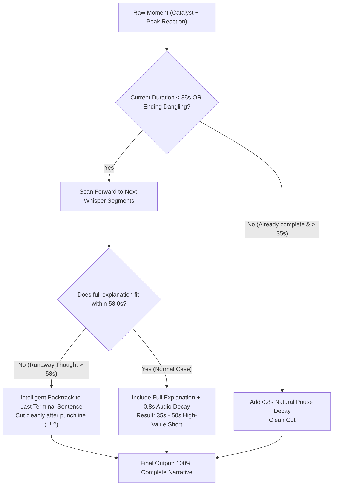

# Cutting Skill Mastery & Clip Boundary Analysis

## 1. Deep Transcript Breakdown of the Uploaded Clip
**File**: `live_004732aa_1794687836_569d1afa.mp4`  
**Duration**: 19.04 seconds  
**Streamer**: Zackrawrr / Asmongold  
**Database Record ID**: `569d1afa-2ec9-455d-865d-76af3335f1ec`

### Word-Level Timestamped Transcript

| Timestamp Range | Spoken Text | Narrative Role |
| :--- | :--- | :--- |
| `00:00 - 04:84` | *"And if they had the BET streamer awards, they had a freestyle and gave you the unword password you go on the show."* | **Catalyst / Setup**: Streamer reads an unhinged question from chat setting up a controversial dilemma. |
| `05:48 - 07:74` | *"Absolutely not. No way."* | **Immediate Reaction / Disbelief**: Instant visceral rejection. |
| `08:10 - 10:08` | *"Not even in a million years, man."* | **Peak Punchline / Resolution #1**: Emphatic refusal delivering the initial comedic punchline. |
| `10:54 - 16:78` | *"So I do think that there is a lot of latent and covert racism in the old school Twitch community."* | **Pivot / Commentary**: Shifts from pure reaction into serious personal perspective and social critique. |
| `17:18 - 18:08` | *"I really think so."* | **Stance Affirmation**: Confirms conviction on the critique. |
| `18:52 - 18.98` | *"And let me."* | ❌ **CRITICAL DEFECT (Cut Off Mid-Thought)**: Speaker begins introducing the core justification/reasoning (*"And let me [tell you why / explain]..."*), and the clip abruptly cuts to black. |

---

## 2. Root Cause: Why Did It Cut at 19 Seconds?

1. **AI "Loop Rate" Bias**:
   - The AI moment detection model returned candidate timestamps `03:34 -> 03:53` with the internal justification:
     > *"His polarizing verdict on Twitch culture sparks heavy comment debate, while the tight 19-second runtime maximizes completion and loop rate."*
   - The AI artificially squeezed the clip to 19s to optimize for short loop metrics, completely ignoring that the speaker was actively mid-sentence.
2. **Missing Semantic Boundary Verification**:
   - The previous system only checked numerical audio segment endpoints without analyzing the grammatical or semantic completeness of the sentence.
   - It treated `19.04s` as a valid boundary simply because Whisper produced a timestamp there, even though the text was `"And let me."`.
3. **Absence of Backtrack / Forward-Expansion Logic**:
   - When the speaker opened a new explanatory clause, the clipper lacked forward-scanning to capture the explanation, and lacked backtrack logic to safely cut after the completed thought (*"Not even in a million years, man."*).

---

## 3. The Cutting Skill: Where to Cut and Where NOT to Cut

### ❌ WHERE NOT TO CUT (Strictly Forbidden)
1. **Dangling Connectives & Conjunctions**:
   - Never cut on: `and`, `but`, `or`, `nor`, `because`, `cause`, `since`, `as`, `although`, `though`, `while`, `whereas`, `if`, `unless`, `until`, `so`.
2. **Introductory / Setup Clauses**:
   - Never cut on: `"And let me..."`, `"Let me tell you..."`, `"The reason why..."`, `"Here is why..."`, `"What happens is..."`, `"Watch this..."`, `"Here it comes..."`, `"Why I wouldn't..."`.
3. **Mid-Explanation or Pre-Payoff**:
   - If a creator answers a premise and begins explaining *why* they took that stance, cutting before the explanation finishes leaves the audience frustrated and ruins watch time.
4. **Micro-Duration Cuts (< 25s)**:
   - Squeezing clips under 25 seconds for loop rate when context or resolution is missing creates low-quality, unusable clips.

### ✅ WHERE TO CUT (The Perfect Out-Point)
1. **Grammatically Terminal Boundary**:
   - The sentence must conclude on a period (`.`), exclamation mark (`!`), or question mark (`?`) where both subject and predicate have resolved.
2. **Natural Silence & Audio Decay**:
   - Add `0.8s - 1.2s` of post-roll after the final word so vocal resonance, laughter decay, or the streamer's reaction face lands organically without clipping audio phonemes.
3. **Target Sweet Spot (35s – 55s, Max 58.0s)**:
   - Always encompass the full 3-act structure:
     - **Setup / Catalyst (0–15s)**: Chat prompt, external video clip, or gameplay scenario.
     - **Climax / Reaction (15–35s)**: Outburst, laugh, denial, or shock.
     - **Resolution / Explanation (35–50s)**: The breakdown of why it happened, final verdict, or comedic punchline.

---

## 4. Engineering Implementation

### A. Semantic Boundary Guard (`is_phrase_incomplete`)
Added to [`backend/src/services/live_stream_service.py`](file:///Users/luv/.gemini/antigravity/scratch/supoclip/backend/src/services/live_stream_service.py#L253-L330):
- Detects dangling conjunctions, transition prepositions, and incomplete phrasal endings.
- Detects anticipation lead-in triggers (e.g., `"here it comes"`, `"watch this"`), ensuring the clip extends past the announcement through the actual event.

### B. Forward Extension & Intelligent Backtrack
- **Forward Extension**: Scans subsequent segments to swallow the full explanation and punchline sentence up to the 42s sweet spot (capped at 58.0s).
- **Intelligent Backtrack**: If a speaker embarks on a lengthy 2-minute rant that cannot fit within YouTube Shorts' 58.0s limit, the engine **backtracks** to the last clean period before the rant started (e.g. cleanly ending after *"Not even in a million years, man."*), guaranteeing zero dangling phrases.

### C. Prompt Reinforcement
- Explicitly instructed the Gemini Flash model to penalize and reject any clip ending on an incomplete thought, setup clause, or dangling connective.
