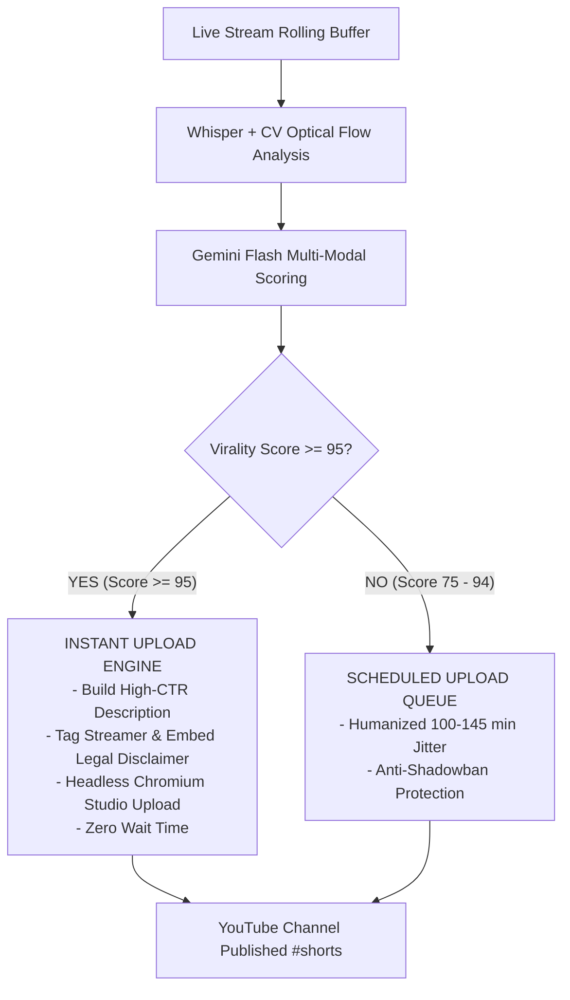

# Instant YouTube Upload & Viral Metadata Engine

## 1. Overview & Policy Rules

As requested, all generated clips with a **virality score of 95 or above** are now prioritized for **instant, automated, headless upload to YouTube** without waiting for the scheduled batch interval. Clips scoring below 95 continue on the humanized 100–145 minute anti-shadowban schedule.

All uploads now adhere to a unified, high-CTR metadata standard incorporating:
1. **Curiosity Teasers & Catching Descriptions**: Psychological hooks that drive audience engagement.
2. **Direct Streamer Attribution**: Tagging the featured creator's official handle (`@handle`) and direct stream URL.
3. **Engagement Call-to-Action (CTA)**: Prompting comments, likes, and subscriptions.
4. **Section 107 Copyright Act Fair Use Disclaimer**: Standardized federal copyright protection language.
5. **Notice to Content Owners & Takedown Email**: Direct contact for seamless removal requests.
6. **High-Velocity Viral Hashtags**: Tailored creator tags and global short-form tags.

---

## 2. Standardized YouTube Description Template

```text
{title}

🔥 {curiosity_teaser}

🎮 Featured Streamer: {streamer_display_name} ({streamer_handle})
📺 Watch the original stream: {stream_channel_url}
⚡ Clipped live with SupoClip AI

💬 Drop your thoughts in the comments below! Did he go too far or was he 100% right?
👍 Like, Share, and Subscribe for daily live stream highlights, funniest streamer moments, and viral reactions!

---
⚖️ COPYRIGHT & FAIR USE DISCLAIMER:
Copyright Disclaimer Under Section 107 of the Copyright Act 1976, allowance is made for "fair use" for purposes such as criticism, comment, news reporting, teaching, scholarship, and research. Fair use is a use permitted by copyright statute that might otherwise be infringing. Non-profit, educational, or personal use tips the balance in favor of fair use.

📩 NOTICE TO CONTENT OWNERS & TAKEDOWN REQUEST:
If you are the copyright holder or featured creator in this video and wish for this clip to be removed from this channel, please contact me directly at:
👉 Email: timewij952@jcaton.com
We respect all content creators and will remove the video immediately upon request with no dispute.
---

{virality_hashtags}
```

---

## 3. Real Published Example

From published Short [`live_004732aa_1794688249_377ef868.mp4`](file:///Users/luv/.gemini/antigravity/scratch/supoclip/backend/clips/live_004732aa_1794688249_377ef868.mp4) (**Score: 95**, Duration: 55.6s):

```text
Watch His Face When He Realizes #shorts

🔥 Features an explosive multi-modal reaction pairing an instant 0-second provocative hook with a sudden chair jump at 00:15 and a peak 5.3-intensity desk slam at 00:20. The narrative transitions seamlessly from initial disbelief to cynical outrage over TwitchCon security controversies, concluding on a sharp satirical punchline at 00:49 for a perfect 49-second completion rate.

🎮 Featured Streamer: Asmongold (Zackrawrr) (@zackrawrr)
📺 Watch the original stream: https://www.twitch.tv/zackrawrr
⚡ Clipped live with SupoClip AI

💬 Drop your thoughts in the comments below! Did he go too far or was he 100% right?
👍 Like and Subscribe for daily live stream highlights, funniest streamer moments, and viral reactions!

---
⚖️ COPYRIGHT & FAIR USE DISCLAIMER:
Copyright Disclaimer Under Section 107 of the Copyright Act 1976, allowance is made for "fair use" for purposes such as criticism, comment, news reporting, teaching, scholarship, and research. Fair use is a use permitted by copyright statute that might otherwise be infringing. Non-profit, educational, or personal use tips the balance in favor of fair use.

📩 NOTICE TO CONTENT OWNERS & TAKEDOWN REQUEST:
If you are the copyright holder or featured creator in this video and wish for this clip to be removed from this channel, please contact me directly at:
👉 Email: timewij952@jcaton.com
We respect all content creators and will remove the video immediately upon request with no dispute.
---

#shorts #asmong #asmongclips #asmonglive #asmongold #zackrawrr #asmon #asmonreacts #asmongoldclips #twitch #kick #streamer #funny #viral #clips
```

---

## 4. Pipeline Integration Architecture



1. **`live_stream_service.py`**:
   - Immediately upon rendering and scoring a clip with `score >= 95`, spawns an asynchronous headless upload task.
2. **`youtube_auto_scheduler.py`**:
   - Runs a fast polling loop (every 30 seconds) that scans the database for any pending $\ge 95$ clips, bypassing the 2-hour delay.
3. **`video_metadata.py`**:
   - Centralized `build_viral_youtube_description()` and `get_streamer_profile()` handles creator tagging dynamically for any streamer (Asmongold, xQc, Kai Cenat, Botez, Adin Ross, IShowSpeed, or any new creator added in the future).
