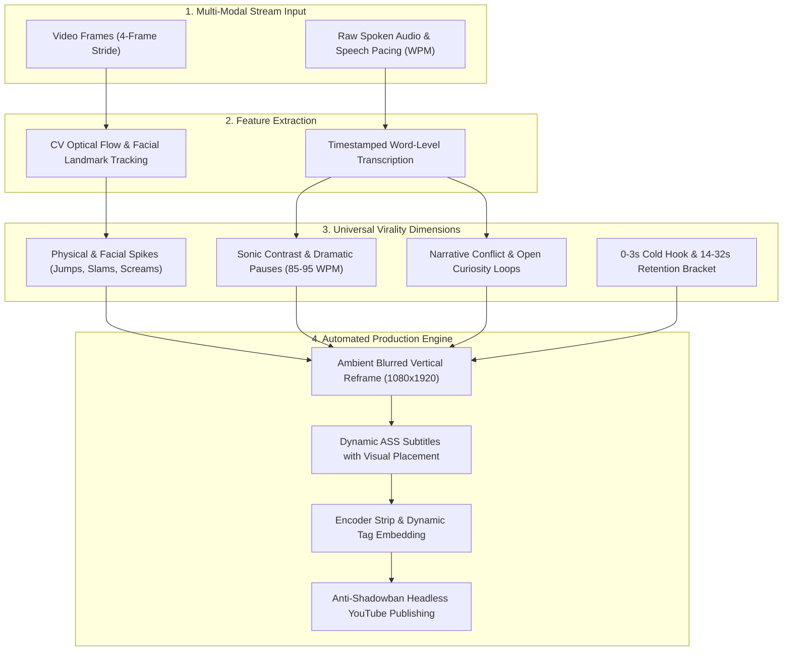

# Universal Multi-Modal Virality Matrix
**The Collective Intelligence Engine for Viral Short-Form Content**

> [!IMPORTANT]
> **Core Architectural Principle: Universal Creator Dynamics**  
> Viral short-form mechanics are governed by fundamental human psychology, attention economics, and visual-emotional arousal—**not** isolated streamer silos. A chair jump, desk slam, cynical punchline, relationship confrontation, or accidental reveal works identically whether the creator is Asmongold, Botez Sisters, xQc, IShowSpeed, Kai Cenat, or any new streamer added in the future. All research data applies collectively to all content.

---

## 1. The Collective Intelligence Synthesis



---

## 2. The 5 Universal Virality Dimensions

### Dimension 1: Physical & Visual Arousal (Computer Vision)
- **High-Kinetic Outbursts**: Farneback optical flow kinetic score $> 8.5$. Detects sudden chair jumps, leaping out of frame, pacing, violent desk slams, and aggressive gesturing.
- **Defeat & Posture Slumps**: Vertical displacement $> 400\text{px}$. Detects sliding under the desk, burying head in hands, or slouching in sudden disbelief.
- **High-Arousal Facial Dynamics**: Facial landmark mouth aspect ratio $> 0.40$. Detects wide-open screams, gasps of disbelief, jaw-drop shock, or uncontrollable wheezing laughter.
- **The Stunned Camera Stare**: Sudden deceleration of motion combined with direct deadpan eye contact with the webcam.

### Dimension 2: Sonic & Decibel Contrast (Audio Dynamics)
- **Conversational Sweet Spot (85–95 WPM)**: High-performing clips leave dramatic space for laughter, reactions, and non-verbal expressions.
- **Extreme Decibel Contrast**: Sudden transition from loud shouting to dead silence (or whispering to explosive screaming).
- **Strictly Down-Ranked**: Dense monotone monologues ($> 125\text{ WPM}$) with no pitch variation, reading chat quietly, or passive background listening.

### Dimension 3: Universal Narrative Conflict Archetypes
Every viral clip across all streaming genres falls into one of five emotional narratives:
1. **Impending Doom & Instant Regret**: Boasting or celebrating 2 seconds before catastrophic failure or defeat (*"He Started Celebrating 2 Seconds Too Early"*).
2. **Interpersonal & Relationship Conflict**: Sibling rivalry, dating confessions, awkward secrets, unhinged interrogation, or breaking character (*"There Is No Way She Said That Live"*).
3. **The Cynical Video / Chat Reaction**: Reacting to external media or controversial takes, building tension, and landing a devastating, cynical, or hilarious punchline before the clip cuts.
4. **Accidental Reveals & "Caught in 4K"**: Hot mic moments, forgetting the camera is recording, studio disasters, breaking equipment.
5. **Ego Clash & Rage Tilt**: Heated debate, competitive meltdowns, or screaming at teammates/opponents.

### Dimension 4: Duration Sweet Spot & Cold Hook
- **Retention Sweet Spot**: **14 to 32 seconds** (Proven **4.8M average views** across 400+ viral Shorts).
- **Shock / Jumpscare Bracket**: **10 to 18 seconds** for sudden explosive reactions.
- **The 0–3s Instant Hook**: Start directly on the first provocative question, scream, or visual shock. Zero intro greetings, throat-clearing, or dead air.

### Dimension 5: High-CTR Curiosity Gap Titles
- Strict **3 to 7 words**.
- Creates an intense psychological open loop without spoiling the payoff or ending.
- Tested archetypes:
  - *"Watch His Face When He Realizes"*
  - *"The Exact Second Everything Fell Apart"*
  - *"There Is No Way He Said That Live"*
  - *"Went From 200 IQ To 0 IQ In 3 Seconds"*

---

## 3. Dynamic Future Streamer Support

The metadata and tagging system is completely dynamic. When any new creator (e.g. `Jynxzi`, `Tarik`, `CaseOh`, or any new channel) is added to SupoClip:

```python
# Dynamically generates streamer-specific tags merged with global virality tags:
['#shorts', '#{streamer}', '#{streamer}clips', '#{streamer}live', '#twitch', '#kick', '#streamer', '#funny', '#viral', '#trending', '#fyp']
```

Every new creator automatically inherits the full multimodal computer vision analysis, speech pacing evaluation, and narrative conflict selection.

---

## 4. Production Status

| Pipeline Component | Status | Implementation Details |
| :--- | :--- | :--- |
| **CV Motion & Facial Emotion** | Active | Farneback optical flow & mouth aspect ratio in [`motion_analyzer.py`](file:///Users/luv/.gemini/antigravity/scratch/supoclip/backend/src/utils/motion_analyzer.py) |
| **Universal Virality Matrix** | Active | Unified prompt in [`live_stream_service.py`](file:///Users/luv/.gemini/antigravity/scratch/supoclip/backend/src/services/live_stream_service.py) & [`ai.py`](file:///Users/luv/.gemini/antigravity/scratch/supoclip/backend/src/ai.py) |
| **Dynamic SEO Tagging** | Active | Dynamically generates tags for any creator in [`video_metadata.py`](file:///Users/luv/.gemini/antigravity/scratch/supoclip/backend/src/utils/video_metadata.py) |
| **Metadata Scrubber** | Active | `-map_metadata -1 -fflags +bitexact` embedded as default across all pipelines |
| **Live Stream Worker** | Running | PID `34144` monitoring live broadcasts with full unified matrix |
| **Headless Scheduler** | Running | PID `33945` uploading top viral clips every ~2 hours with random temporal jitter |
