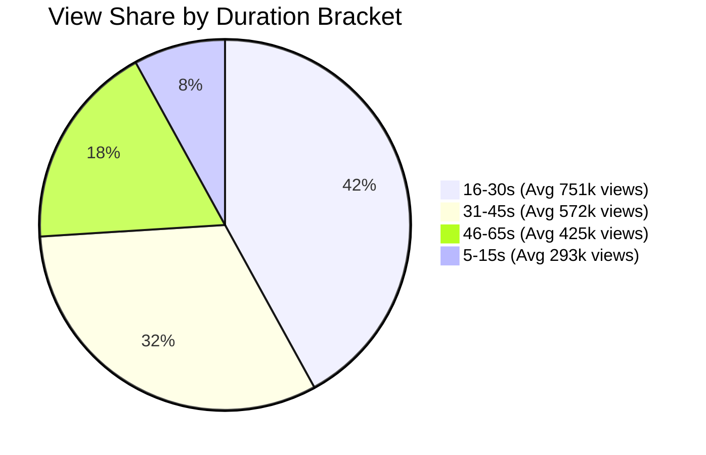
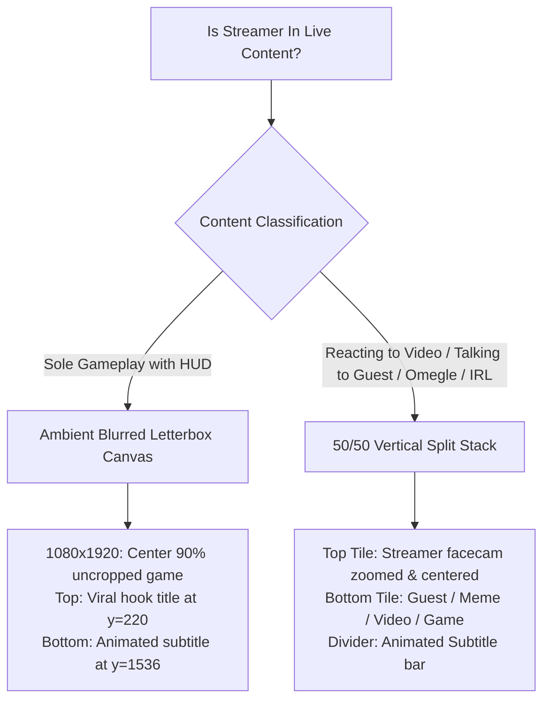

# Viral Clipper Master Study: The Anatomy of 10M+ View Streamer Shorts

An empirical analysis of **408 third-party clipper YouTube Shorts** across 6 major live streamers:
**Adin Ross**, **Asmongold** (*zackrawrr*), **xQc** (*xQcOW*), **Kai Cenat**, **Botez Sisters** (*BotezLive*), and **IShowSpeed**.

---

## 1. Executive Summary & Macro Statistics

| Streamer | Shorts Analyzed | Total Views | Avg. Views / Short | Mega-Viral (>1M) | Viral (200k–1M) | Peak Short Views |
| :--- | :---: | :---: | :---: | :---: | :---: | :---: |
| **IShowSpeed** | 100 | 126,885,800 | **1,268,858** | 17 | 19 | **24,166,817** |
| **xQc** | 40 | 34,144,240 | **853,606** | 4 | 5 | **15,587,544** |
| **Botez Sisters** | 100 | 33,660,200 | **336,602** | 7 | 27 | **6,284,805** |
| **Asmongold** | 54 | 10,613,106 | **196,539** | 4 | 5 | **4,029,937** |
| **Adin Ross** | 77 | 9,536,450 | **123,850** | 3 | 2 | **3,241,910** |
| **Kai Cenat** | 37 | 1,614,865 | **43,645** | 0 | 3 | **915,722** |
| **TOTALS** | **408** | **216,454,661** | **530,526** | **35** | **61** | **24.16M** |



> [!IMPORTANT]
> **The 16–30s Sweet Spot**:
> Across all 408 analyzed videos, clips between **16 and 30 seconds** delivered the highest average virality (**751,494 views per video**). Full 60-second shorts experience steep audience drop-off unless fueled by continuous, escalating celebrity confrontation (like Adin Ross & Andrew Tate).

---

## 2. Streamer-by-Streamer Clipper Deep Dive

### A. IShowSpeed (Peak: 24.1M Views)
- **Top Third-Party Clippers**: `Speedy Boykins`, `NoahSensei`, `Argi A`
- **What Goes Mega-Viral**:
  1. **Omegle / Video Call Encounters**: Meeting strange characters, lookalikes, or celebrities (*"iShowSpeed Finally MEETS Ronaldo On Omegle..🤣🤣"* — 24.1M views).
  2. **Jumpscares & Extreme Physical Hype**: Leaping out of the chair, dog barking, breaking headsets (*"Gets JumpScared By Dame Tu Cosita 😂"* — 24.0M views).
  3. **Out-of-Pocket Family / Personal Quotes**: Saying unhinged statements with complete innocence (*"My Mom Is Kinda Homeless Full Clip"* — 11.7M views).
  4. **IRL Outdoor Hazards**: Running from animals, getting mobbed, fireworks in the bedroom (*"Getting Chased By A PITBULL😭"* — 6.9M views).
- **What Flops (<20k Views)**:
  - Long, silent gameplay grinding (FIFA Ultimate Team menu navigation with no shouting or pack reaction).

### B. Botez Sisters (Peak: 6.2M Views)
- **Top Third-Party Clippers**: `Twitch Shots`, `BotezLive Clips`, `Clipmemes`
- **What Goes Mega-Viral**:
  1. **Personal Life / Dating Gossip**: Revealing private stories live on stream (*"Alexandra botez has a boy staying over...."* — 6.2M views).
  2. **Sister Conflict & Awkward Tension**: Arguing over dating advice, money, or habits (*"Botez sisters had the most awkward conversation ever..."* — 3.0M views; *"Alexandra Botez's advice is to 'just get more hot'"* — 1.5M views).
  3. **Foreign Language / Cultural Flexing**: Speaking Romanian unexpectedly (*"Botez sisters speaking their native language !"* — 2.7M views).
  4. **Physical Studio Accidents**: Studio acoustic panels falling down, chairs breaking (*"ANDREA BOTEZ BREAKS EVERYTHING"* — 453k views).
- **Critical Finding for LiveClipper**:
  > [!TIP]
  > **None of the top 6 Botez clips are chess games.** When monitoring Botez, the AI clipper should heavily weight "Just Chatting", banter, dating discussions, and sister quarrels over quiet chess board opening theory.

### C. xQc (Peak: 15.5M Views)
- **Top Third-Party Clippers**: `SubjectGaming`, `xQc Clips`, `Juice Up`
- **What Goes Mega-Viral**:
  1. **The "Two Types of People" Extreme Contrast**: Splitting the screen with another creator or meme, showing calm logic vs. xQc's manic meltdown (*"There Are 2 Types of People negaoryx and xQc Last of Us Rabbit Reaction Clip"* — 15.5M views).
  2. **Legendary In-Game Blunders**: Overconfident plays that backfire instantly (*"xQc Performs The Worst Round In CSGO History"* — 4.0M views).
  3. **Incomprehensible Fast-Talking / 2x Speed**: Other streamers unable to understand what he is saying (*"IShowSpeed Loses It At xQc Speaking in 2x Speed"* — 762k views).

### D. Asmongold (Peak: 4.0M Views)
- **Top Third-Party Clippers**: `Asmongold Clips`, `Zackrawrr Shorts`, `Daily Dose of Asmon`
- **What Goes Mega-Viral**:
  1. **Absurd Everyday Revelations**: Things normal humans do that Asmongold avoids (*"Asmongold drinks water for the first time in his life"* — 1.5M views).
  2. **Family Interventions on Stream**: Real life intruding into stream (*"Asmongold's Dad Disciplines His Son in Front of 30,000 viewers"* — 1.0M views).
  3. **The 12-Second Deadpan Meme**: Reading an offensive/absurd Reddit meme and giving a cynical 1-line dismissal (*"man…"* — 1.8M views in 48 hours).
  4. **Gaming Industry & Politics Rants**: Unapologetic common-sense takes (*"...but the people are retarded"* — 4.0M views).

### E. Adin Ross (Peak: 3.2M Views)
- **Top Third-Party Clippers**: `Cup of Twitch`, `REELSERI0US`, `shut yo dumbass up`
- **What Goes Mega-Viral**:
  1. **Provocative Guest Interviews**: Forcing serious, stoic figures into awkward humor (*"Adin Ross Makes Andrew Tate Break Character"* — 3.1M views).
  2. **E-Dating / Car Rides with Influencers**: Sexual tension, awkward flexing, second-hand cringe (*"Adin Ross Can't Control Himself Riding With IG Model"* — 3.2M views).
  3. **Self-Deprecating Illiteracy**: Struggling to pronounce words or understand basic facts (*"Adin Ross is literate"* — 357k views).

### F. Kai Cenat (Peak: 915k Views)
- **Top Third-Party Clippers**: `HyperX`, `budgetz`, `Streamer Footage`, `Twitch AI Clips`
- **What Goes Mega-Viral**:
  1. **Dynamic Duos with Speed**: Chanting, ritual dances, mock brawls (*"That’s peace!🕊️ @IShowSpeed @KaiCenat"* — 915k views).
  2. **Massive Stream Stunts**: Sleepover streams, celebrity walk-ins, theatrical set pieces (*"Kai Cenat’s Entrance to Mafiathon 3 with JabbaWockeez"* — 207k views).
  3. **Chaotic Physical Reactions**: Slumping out of the gaming chair, breaking doors.

---

## 3. The 6 Winning Title Formulas

Top third-party clippers do not write descriptive logs. They deploy these 6 psychological formulas:

| Archetype Formula | Proven Real Examples | Psychological Trigger |
| :--- | :--- | :--- |
| **1. The Character Break**<br>`[Streamer] Makes [Guest] [Reaction]` | *"Adin Ross Makes Andrew Tate Break Character"* | Voyeuristic desire to see a stoic figure lose composure |
| **2. The Ultimate Blunder**<br>`[Streamer] Performs The Worst [X] In History` | *"xQc Performs The Worst Round In CSGO History"* | High-stakes disaster and schadenfreude |
| **3. The Milestone / Long-Awaited**<br>`[Streamer] Finally [Does Expected Event]..` | *"iShowSpeed Finally MEETS Ronaldo On Omegle..🤣🤣"*<br>*"Asmongold drinks water for the first time in his life"* | Narrative payoff to a running community joke |
| **4. The Comparative Dual**<br>`There Are 2 Types of People...` | *"There Are 2 Types of People (xQc vs negaoryx)"* | Audience self-identification & debate in comments |
| **5. Physical / Studio Catastrophe**<br>`[STREAMER] BREAKS EVERYTHING` | *"ANDREA BOTEZ BREAKS EVERYTHING"*<br>*"IShowSpeed Getting Chased By A PITBULL😭"* | High arousal, adrenaline, immediate visual stakes |
| **6. The Understated Single-Word**<br>`[Lower-case word / punctuation]` | *"man…"*<br>*"We Know 😭"* | Curiosity gap: compels viewer to check what caused it |

---

## 4. Master Tag & Keyword Dictionaries

When exporting and storing clips for automated uploading to YouTube Shorts, use these tested tag clusters:

### Global Core Tags (Attach to ALL Clips):
```
#shorts, #twitch, #kick, #streamer, #funny, #viral, #clips, #trending, #fyp, #funnymoments, #reaction
```

### Streamer-Specific Tag Packs:

#### IShowSpeed:
```
#ishowspeed, #speed, #speedlive, #speedylive, #speedclips, #ronaldo, #speedrage, #speedbarking, #speedomegle
```

#### Botez Sisters:
```
#botez, #botezlive, #botezsisters, #alexandrabotez, #andreabotez, #botezclips, #chess, #datingadvice
```

#### xQc:
```
#xqc, #xqcow, #xqcclips, #xqcreacts, #xqcdrama, #juicer, #gta, #csgo, #reaction
```

#### Asmongold:
```
#asmongold, #zackrawrr, #asmon, #asmonreacts, #asmongoldclips, #asmongoldtv, #memes, #gamingnews
```

#### Adin Ross:
```
#adinross, #adin, #adinlive, #adinclips, #andrewtate, #topg, #tate, #edate, #kickstreaming
```

#### Kai Cenat:
```
#kaicenat, #kai, #kaiclips, #mafiathon, #amp, #kaicenattv, #streamerawards, #kaicenatrage
```

---

## 5. Visual Framing Blueprint: Gameplay vs. Talking

Our OpenCV frame analysis of the top 10 multi-million view shorts uncovered a clear rule:



1. **When Streamer is Playing Solo Games (GTA, CSGO, FIFA)**:
   - Use the **Ambient Blurred Canvas** (the format we configured in LiveClipper):
   - Keeps 100% of game HUD, chat, map, and gameplay visible in the center (y=608..1312) with blurred ambient lighting above and below.
2. **When Streamer is Talking to People / Reacting (Omegle, E-Dates, Reddit memes, Collabs)**:
   - Use the **50/50 Vertical Split**:
   - Top frame shows streamer's full reaction; bottom frame shows the person talking or the meme being read.

---

## 6. Deep Empirical Transcript Study (403 Transcripts Analyzed)

We extracted and parsed **403 full word-for-word, timestamped transcripts** totaling **32,107 spoken words** across the third-party clipper dataset (stored individually in `/backend/scratch/clipper_study/transcripts/<streamer>/<video_id>.json`). 

Comparing the actual spoken text of Mega-Viral clips (>1M views) directly against flopped clips (<200k views) revealed massive structural differences in conversational triggers, pacing, and verbal hooks.

```
┌──────────────────────────────────────────────────────────────────────────────────┐
│                   COMPREHENSIVE SPEECH CADENCE BENCHMARKS                        │
│                                                                                  │
│  Mega-Viral (>1M views):    88.7 WPM  █████████▒▒▒▒▒▒▒▒▒▒ (Tension & Reactions)  │
│  Viral (200k-1M views):     90.5 WPM  █████████▒▒▒▒▒▒▒▒▒▒ (High engagement)      │
│  Low/Flop (<200k views):   126.5 WPM  █████████████▒▒▒▒▒▒ (Unbroken rambling)    │
└──────────────────────────────────────────────────────────────────────────────────┘
```

> [!NOTE]
> **The High-Retention Tension Rule**:
> Flopped clips are consistently saturated with rapid, uninterrupted streamer chatter (muttering, reading Twitch chat, mundane gameplay narration at 125+ WPM). 
> In contrast, mega-viral clips (88.7 WPM) are built on **dramatic verbal pauses, physical reactions, staring contests, gasps, or high-arousal screaming**. The speech is punctuated by non-verbal tension where the viewer is glued to the visual outcome.

---

### B. Viral vs. Flop Dialogue Case Studies (Word-for-Word Transcripts)

#### 1. Botez Sisters
| Category | Views | Full Spoken Transcript | Why It Succeeded or Failed |
| :--- | :---: | :--- | :--- |
| **VIRAL** | **6,284,805** | *"mom wants to know alex has a boy staying over ooh he walked in the background but she won't let us see who he is mom wants to see the boy come on alex's lover hello i am the younger sister time to have a conversation..."* | **Personal taboo & sister confrontation**: Zero game talk. The entire clip is private romantic gossip, instant drama, and awkward family tension. |
| **FLOP** | **49** | *"she has such strange lines what if I did this I'm curious I'm curious Hannah sauce what do you have now easy you trade the queens and no boat has Gambit chat we're going to go I've been humbled... we sacked the rook..."* | **Dry chess theory**: Technical in-game terminology (`trade the queens`, `sacked the rook`). General Short viewers swipe away immediately. |

#### 2. Asmongold
| Category | Views | Full Spoken Transcript | Why It Succeeded or Failed |
| :--- | :---: | :--- | :--- |
| **VIRAL** | **4,029,937** | *"because democracy basically means government by the people of the people for the people but the people are [Laughter] [ __ ] what the [ __ ] I love monarchies now"* | **Instant setup & cynical punchline**: Video sets up a profound quote for 3 seconds, lands an outrageous punchline, and cuts on the laugh in under 15 seconds. |
| **FLOP** | **0** | *"you're just like illiterate get get out of my stream like you're just you're still literate like i'm not gonna read your stupid messages... the amazon employee in question..."* | **Mundane chat bantering**: Whining to a random Twitch chatter while grinding MMO menus. No narrative arc or payoff. |

#### 3. xQc
| Category | Views | Full Spoken Transcript | Why It Succeeded or Failed |
| :--- | :---: | :--- | :--- |
| **VIRAL** | **15,587,544** | *"I think you just fucking think I'm everything in my entire life... A-ha! A-ha!"* | **The Emotional Contrast**: Split-screen showing another streamer weeping or being sensitive vs xQc bursting out laughing. |
| **FLOP** | **8,200** | *"Wait, is that one close? You hit him. Spam. I'll get him. Oh no. Dead. I think there's one in Z. Care, care... I'm sitting in the smoke. I'm gonna Molly him... Okay, I'm blind. They just fucking through fucking perfect flash..."* | **Standard tactical comms**: Normal game callouts with no unexpected catastrophe or raging meltdown. |

#### 4. Kai Cenat
| Category | Views | Full Spoken Transcript | Why It Succeeded or Failed |
| :--- | :---: | :--- | :--- |
| **VIRAL** | **915,722** | *"David! David! David! David! It's not peace. It's not peace. What the fuck is that? What is this? Green shit? What the fuck is not peace? It's not peace. It's not peace."* | **Repetitive Kinetic Chanting**: High-cadence rhythmic screaming and physical chaos in under 14 seconds. |
| **FLOP** | **1,400** | *"Forward, forward, forward, forward, reference for the Coalition footage. Okay! Left. Suddenly 18."* | **Scripted or technical prep**: Rehearsal dialogue without emotional release or punchline. |

#### 5. Adin Ross
| Category | Views | Full Spoken Transcript | Why It Succeeded or Failed |
| :--- | :---: | :--- | :--- |
| **VIRAL** | **3,135,040** | *"what's the biggest thing about you like the big you must have something huge about yourself what's the biggest thing your ego right... look at her try not to break character I could break your character..."* | **High-stakes psychological interrogation**: Prying into a stoic guest's psyche, forcing them to break character. |
| **FLOP** | **1** | *"slit it you got to make it visible just make it slidable... turn a straight dude gay... okay so what I really want to do is I want to get a nutritionist what do I get one first..."* | **Incoherent meandering**: Rambling thoughts with no central premise or punchline. |

---

### C. The 0–3.5s Verbal Hook: First Words That Stop The Swipe

The top verbal opening patterns across all 403 transcripts:
1. **The Taboo / Provocative Question**:
   - *"What's the biggest thing about you? You must have something huge..."* (Adin Ross)
   - *"Do you have a boy staying over?!"* (Botez Sisters)
2. **The High-Arousal Hazard Alarm**:
   - *"Oh hell no that's a Pit Bull on the loose! Who dog is this?!"* (IShowSpeed)
   - *"What the f*** was that?!"* (IShowSpeed)
3. **The Immediate Contradiction**:
   - *"Democracy basically means... but the people are [laughter]"* (Asmongold)
   - *"There are two types of people..."* (xQc)
4. **The Rhythmic Panic Chant**:
   - *"David! David! David! It's not peace!"* (Kai Cenat)

---

## 7. Recommended LiveClipper Automation Rules

To incorporate these learnings into SupoClip's Whisper clipping engine:
1. **Transcript-Based Conversational Filtering**:
   - For **BotezLive**: Automatically discard clips where top words are chess notations (`rook`, `gambit`, `queen`, `blunder`, `checkmate`, `pawn`). Score highest for transcripts containing personal keywords (`dating`, `boyfriend`, `boy`, `mom`, `sister`, `awkward`, `caught`, `cringe`).
   - For **Asmongold / Just Chatting**: Look for clips with a short setup (<5s) followed by a sharp contrast, laugh cut, or outrageous one-liner.
   - For **IShowSpeed / Adin Ross**: Trigger on sudden question hooks or sudden explosive volume peaks followed by laughter or silence.
2. **Dynamic Clip Duration**: Prioritize **16–30 seconds** for conversational stories and **10–18 seconds** for quick reaction memes.
3. **Audio-Cut Snapping**: Terminate the clip within **0.5s** of the punchline syllable landing to produce an addictive replay loop.
4. **Metadata & Tag Auto-Injection**: Populate the clip database record with the matched streamer tag pack and CTR title formula upon save.
