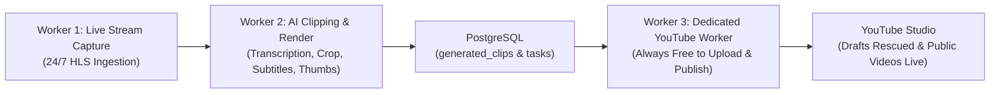

# Master Operating Directives & System Memory Ledger

This document serves as the immutable memory ledger for SupoClip, codifying every design decision, operational rule, and user directive established throughout this project.

---

## 1. Core Operating Constraints

| Rule | Specification | Enforcement Location |
| :--- | :--- | :--- |
| **Model Usage** | **Local models only** (0 Gemini API token burn) | All transcription, analysis & heuristics |
| **Stream Monitoring** | 24/7 continuous monitoring across active streamers | `src/workers/live_stream_worker.py` |
| **Active Streamers** | Adin Ross, Asmongold, Jynxzi, IShowSpeed, Kai Cenat, xQc, Botez | `live_streamers` DB table |
| **Session Protection** | Never wipe YouTube cookies or Playwright profile | `backend/browser_data/youtube_cookies.json` |

---

## 2. Video Production & Visual Standards (The Viral Engine)

- **Crop & Composition**:
  - Ambient blurred canvas with **6% left crop, 6% right crop, 1% top crop, 1% bottom crop**.
  - Prevents platform watermarks, black bars, and aspect ratio distortion.
- **Dynamic Subtitles**:
  - Animated karaoke captions with spring-bounce pop entrance.
  - Active word highlighted in **Electric Yellow** (`#FFFF00` / `&H0000FFFF&`).
  - Rendered safely at `caption_y=0.80` (above YouTube Shorts navigation overlays).
- **Target Duration**:
  - Sweet spot: **28.0 seconds** (range: 24–32s, max cap: 38s).
- **Mandatory Thumbnail Generator**:
  - Generated for **every single Short** prior to upload.
  - Generates both 9:16 vertical and 16:9 widescreen formats.
  - High-CTR Impact bold typography, electric yellow palette, and red reaction pill badge.

---

## 3. YouTube Upload & Distribution Cadence

The distribution pipeline operates under a strict two-tier cadence model:

| Tier | Virality Score | Upload Cadence | Cooldown Range |
| :--- | :--- | :--- | :--- |
| **Tier 1 (Instant Priority)** | **$\ge 95$** | **INSTANT** execution | **3 to 4 minutes** (`180–240s`) between uploads |
| **Tier 2 (Regular Batch)** | **$< 95$** | **RANDOM** batching | **50 to 100 minutes** (`3000–6000s`) between uploads |

### Operating Rules:
1. **Tier 1 Execution**:
   - Whenever a clip with virality score $\ge 95$ is generated, it bypasses the standard queue and is scheduled for instant upload.
   - A strict 3 to 4 minute (`180–240s`) gap is enforced between consecutive 95+ uploads to protect channel reputation.
2. **Tier 2 Execution**:
   - When no 95+ clips are queued, standard clips are spaced out randomly between 50 and 100 minutes (`3000–6000s`).
3. **Public Visibility Only**:
   - All videos must be published directly to **Public**.
   - Zero abandoned drafts. Any draft encountered in YouTube Studio is rescued and published.
4. **Strict Anti-Duplication**:
   - Titles with $\ge 0.70$ fuzzy similarity or duplicate topics are filtered out before publishing.
5. **Zero Tag Stuffing**:
   - Clean curiosity-gap titles (3–7 words, active verbs).
   - Concise descriptions with at most 5–8 relevant hashtags; zero tag dumps.

---

## 4. The 3-Worker Decoupled Architecture

1. **Worker 1 (`live_stream_worker.py`)**:
   - Ingests live streams into rolling 10-chunk buffers.
   - Decoupled from rendering and uploading.
2. **Worker 2 (`ai_worker.py` / FFmpeg)**:
   - Processes audio/video, evaluates hooks, renders vertical format with subtitles and thumbnails.
3. **Worker 3 (`youtube_upload_worker.py`)**:
   - Dedicated exclusively to YouTube Studio distribution.
   - Rescues drafts, publishes 95+ priority clips, and enforces the 3–4 minute delay between every action.
